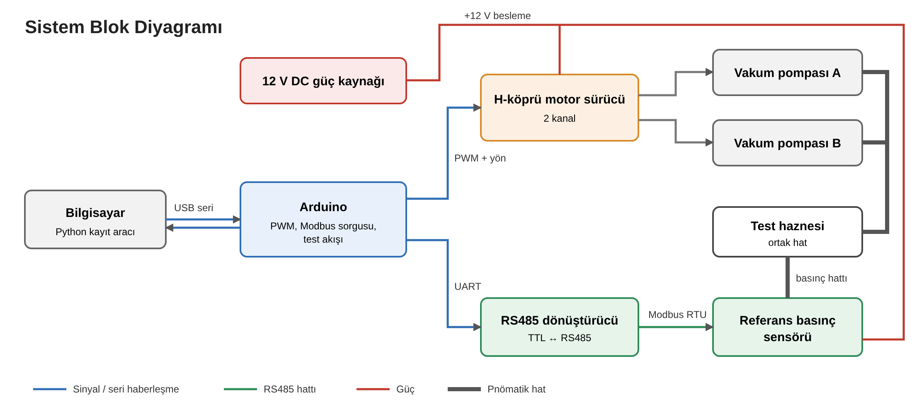

# 2. Sistem Mimarisi

Sistem dört ana bloktan oluşur:

| Blok | Görev |
|---|---|
| **Kontrol** | Arduino; pompaları sürer, sensörü sorgular, test akışını yönetir. |
| **Basınç üretimi** | H-köprü motor sürücü ve iki vakum pompası; test haznesinde basınç oluşturur. |
| **Ölçüm** | Referans basınç sensörü ve RS485 dönüştürücü; hazne basıncını ölçer. |
| **Kayıt** | Bilgisayar ve Python aracı; ölçümleri dosyaya kaydeder. |

## Akışlar

- **Kontrol akışı:** Bilgisayar → (USB seri) → Arduino → (PWM) → Motor sürücü → Pompalar
- **Ölçüm akışı:** Hazne → Referans sensör → (RS485 / Modbus RTU) → Arduino → (USB seri) → Bilgisayar
- **Hava akışı:** Pompalar → ortak hat → Test haznesi → Sensör
