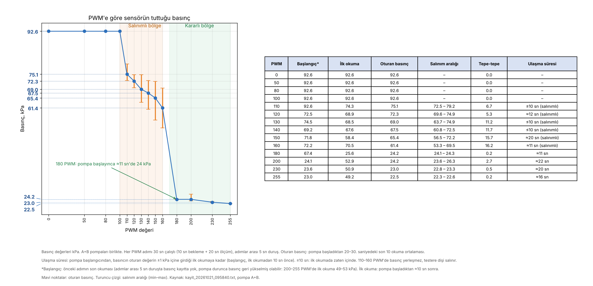

# 6. Sonuçlar ve Değerlendirme

## 6.1 Ölçüm sonuçları

| PWM | Ortalama basınç (kPa, mutlak) | Tepe-tepe salınım (kPa) |
|---|---|---|
| 0–100 | 92,6 (ortam) | 0,0 |
| 110 | 75,1 | 6,9 |
| 130 | 69,5 | 11,8 |
| 160 | 61,3 | 19,0 |
| 180 | 24,4 | 1,6 |
| 255 | en düşük 22,3 | – |

## 6.2 Değerlendirme

- **Ölçüm zinciri güvenilir:** Sensör gürültüsü yaklaşık 0,01 kPa.
- **Başlatma eşiği:** Pompalar 100 PWM altında çalışmıyor.
- **Salınım:** 110–160 PWM arasında basınç 7–19 kPa salınıyor; bu aralıkta kararlı kontrol zor.
- **Alt sınır:** Ulaşılabilen en düşük basınç yaklaşık 22 kPa; hedeflenen en düşük basınca inilemiyor.
- **Donanım sınırı:** Motor sürücü uzun çalışmada aşırı ısındı, ikinci pompa basınca katkı vermedi.

## 6.3 Karar

Pompa tabanlı çözüm gereksinimleri (G-01, G-03) karşılamadığı için sistemde değişikliğe gidilmesine karar verilmiştir.

## 6.4 Mevcut durum

**Proje devam ediyor.** Bu repodaki sonuçlar ilk prototipin (pompa tabanlı düzenek) test sonuçlarıdır.
Test bulgularına göre yeni mimarinin tasarımı ve bileşen seçimi sürmektedir.

## 6.5 Sonraki adımlar

- Yeni mimarinin bileşen seçiminin tamamlanması
- Basıncı hedef değerde tutan kapalı çevrim kontrolün geliştirilmesi
- Hazne sızdırmazlık (kaçak) testinin yapılması
- Yeni düzenekle testlerin tekrarlanması
