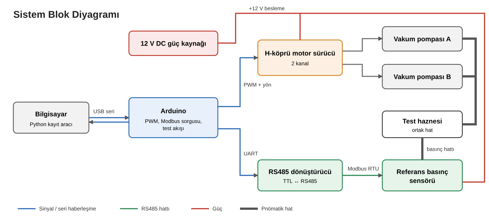
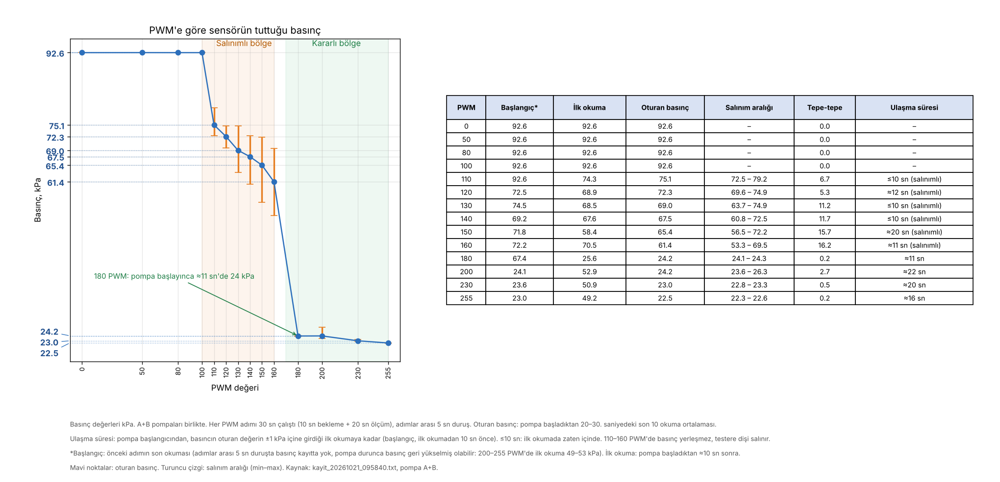

# Basınç Test Düzeneği

**Staj projesi · Ekim 2026 · Beril Mercan**

> **Durum:** Devam ediyor. Bu repo, ilk prototipin kurulumunu ve test sonuçlarını içerir.

Geniş bir mutlak basınç aralığında basınç üretip referans sensörle ölçen
bir test düzeneğinin ilk prototipini kurdum, programladım ve test ettim.

## Projenin amacı

Basınç ölçen cihazların doğruluğunu düzenli olarak kontrol etmek gerekir.

Bu proje, bu kontrolü yapabilmek için **istenen basıncı üretip sabit tutabilen** ve bu
basıncı **hassas bir referans sensörle ölçüp kaydeden** bir test düzeneği geliştirmeyi amaçlar.

## Neden bu düzenek?

- Kalibrasyon için atmosferin hem altında hem üstünde bilinen basınçlar gerekir.
- Elle ayarlanan basınçlar yavaş ve tekrarlanması zordur.
- Basıncı yazılımla kontrol eden ve sonuçları otomatik kaydeden bir sistem, testleri hızlı ve tekrarlanabilir yapar.

## Nasıl ilerledim

1. **Gereksinimleri inceledim:** Basınç aralığını, hassasiyet hedefini ve kullanılacak bileşenleri belirledim.
2. **Ölçümü kurdum:** Referans sensörü önce bilgisayardan, sonra Arduino üzerinden okumayı başardım.
3. **Basınç üretimini kurdum:** Vakum pompalarını sürücü devresiyle Arduino'ya bağladım ve hızlarını PWM ile kontrol ettim.
4. **Sorunları çözdüm:** Pompaların çalışmamasına yol açan bağlantı hatalarını ölçüm yaparak buldum.
5. **Testi otomatikleştirdim:** Pompa hızını adım adım değiştirip basıncı kaydeden bir test akışı yazdım.
6. **Sonuçları analiz ettim:** Pompaların hedefe ulaşamadığını veriyle gösterdim. Bu sonuçla pnömatik bir tasarıma geçiş kararı alındı.
7. **Devam eden çalışma:** Yeni mimarinin tasarımı ve bileşen seçimi sürüyor.

## Neler yaptım

- **Sensör entegrasyonu:** Hassas referans basınç sensörünü RS485 üzerinden Modbus RTU protokolüyle Arduino'ya bağladım ve okuma yazılımını geliştirdim.
- **Pompa kontrolü:** İki vakum pompasını H-köprü motor sürücüyle PWM kontrollü çalıştıran devreyi kurdum ve yazılımını yazdım.
- **Otomatik test sistemi:** PWM taramasını kendi kendine yapan Arduino yazılımını ve sonuçları bilgisayara kaydeden Python aracını geliştirdim.
- **Donanım hata ayıklama:** Ortak toprak eksikliği ve besleme çakışması gibi sorunları ölçerek bulup çözdüm.
- **Analiz ve karar:** Test verisini analiz ettim. Pompa çözümünün sınırlarını gösterdim ve sistemin pnömatik mimariye geçmesine katkı sağladım.

## Sonuçlar

- Ölçüm zinciri güvenilir: sensör gürültüsü yaklaşık **0,01 kPa**.
- Pompalar 100 PWM altında başlamıyor. 110–160 PWM arasında **7–19 kPa** salınım oluşuyor.
- Ulaşılabilen en düşük basınç yaklaşık **22 kPa**. Hedeflenen en düşük basınca pompalarla inilemiyor.
- Bu bulgularla pompa yerine **kompresör + vakum ejektörü + hassas regülatör + solenoid valf** mimarisine geçilmesine karar verildi. Yeni mimari üzerinde çalışma devam ediyor.

## Kullanılan teknolojiler

Arduino (C++) · Python · Modbus RTU · RS485 · PWM motor kontrolü · Pnömatik devre tasarımı

## Repo içeriği

Repo, bir sistem kurulum dokümanı düzeninde ana başlıklara ayrılmıştır:

| No | Bölüm | İçerik |
|---|---|---|
| 1 | [Gereksinimler](01_Gereksinimler) | Sistemden beklenen işlevler ve teknik şartlar |
| 2 | [Sistem Mimarisi](02_Sistem_Mimarisi) | Ana bloklar, blok diyagram, kontrol / ölçüm / hava akışı |
| 3 | [Donanım Mimarisi](03_Donanim_Mimarisi) | Elektronik bileşenler, pin bağlantıları, güç, pnömatik kısım |
| 4 | [Yazılım Mimarisi](04_Yazilim_Mimarisi) | Test yazılımı (Arduino) ve kayıt aracı (Python) |
| 5 | [Entegrasyon ve Test](05_Entegrasyon_ve_Test) | Kurulum sırası, sorunlar ve çözümler, test yöntemi |
| 6 | [Sonuçlar ve Değerlendirme](06_Sonuclar_ve_Degerlendirme) | Ölçüm sonuçları, değerlendirme, mevcut durum ve sonraki adımlar |

---

*Bu repo staj çalışmamın kişisel portföy sürümüdür. Şirkete ait gizli bilgi içermez.*
